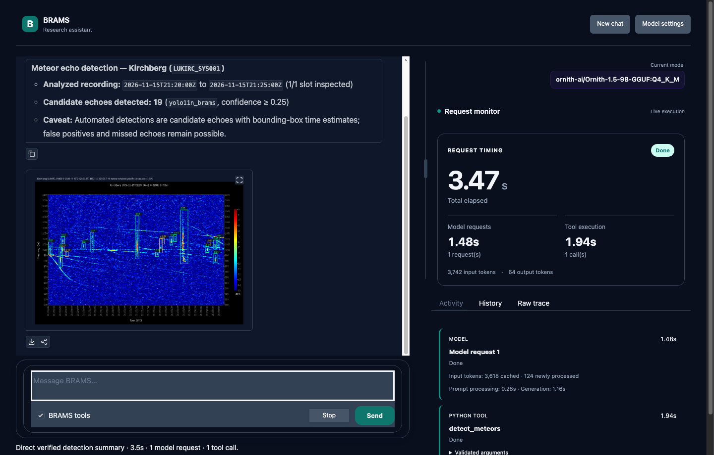
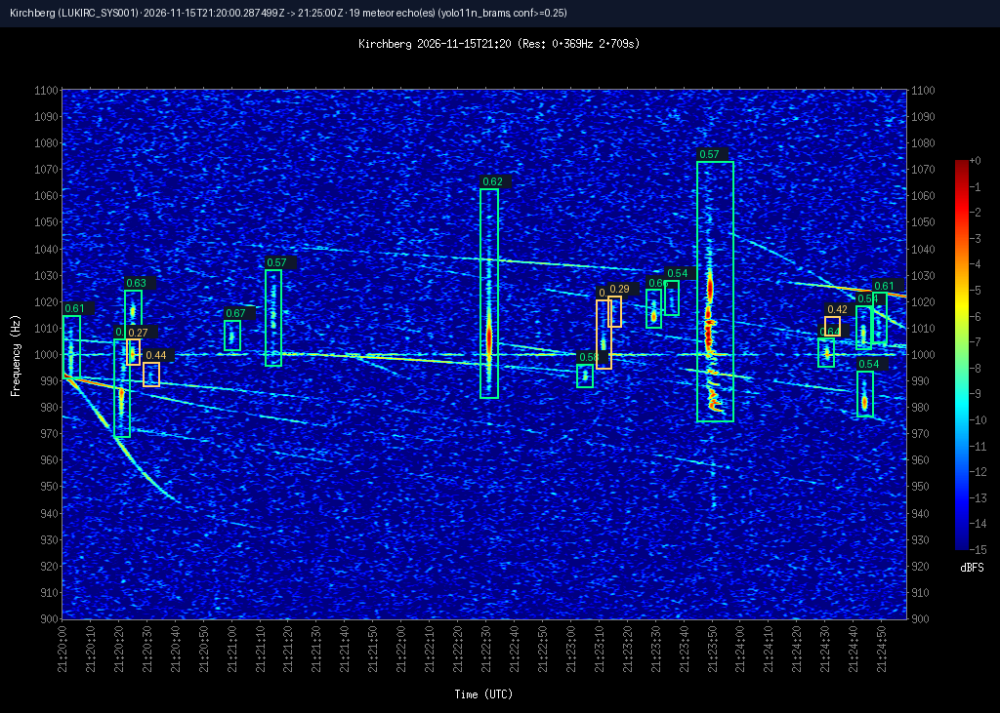
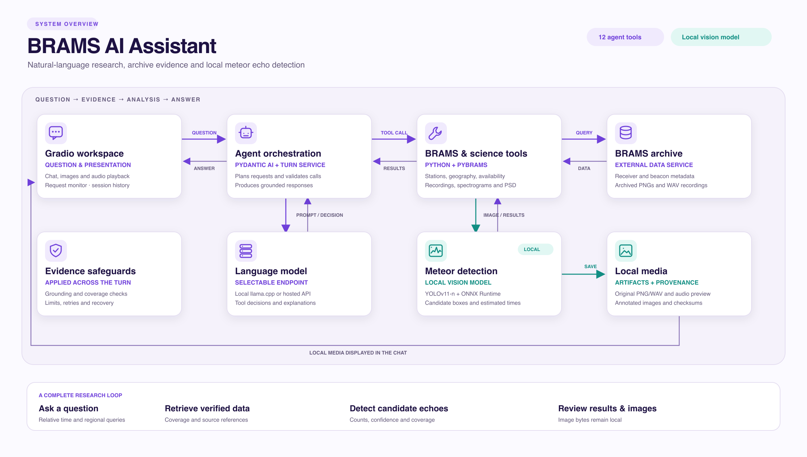

# BRAMS AI assistant: local Ornith or hosted OpenAI-compatible models

[](https://github.com/armanruet/brams-ai-agent/actions/workflows/ci.yml)
[](LICENSE)


Project diagrams: [Interactive architecture](docs/diagrams/readme-architecture.html) ·
[Presentation image](docs/diagrams/readme-architecture.png) ·
[Diagram guide](docs/diagrams/README.md).

A domain-scoped Python assistant for Belgian RAdio Meteor Stations (BRAMS) research:

**Gradio chat → Pydantic AI agent → BRAMS tools and local meteor detection**

It defaults to a local `llama.cpp` model preset with **domain-scoped assistance**
(`ASSISTANT_SCOPE=domain`), **cooperative task cancellation** (Stop button cancelling
in-flight LLM runs, archive downloads, and multi-slot vision scans), **context-window
budgeting**, session-scoped local/public model switching, live request monitoring,
real PyBRAMS coordinate, beacon, recording, availability, spectrogram, WAV and PSD
tools, Belgian geographic station queries, and a local YOLOv11-n meteor echo detector.
Answers appear when an agent turn finishes; the request monitor shows live model
and tool activity while it runs. Individual answer tokens are not streamed.
No model weights are downloaded by this project.

## Interface & meteor detection preview



<details>
<summary>Close-up: local YOLOv11-n meteor echo detection on an archived BRAMS spectrogram (click to expand)</summary>



*Example `detect_meteors` output (`Kirchberg / LUKIRC_SYS001`, `2026-11-15 21:20–21:25 UTC`): vertical underdense and overdense meteor echoes are boxed with confidence scores while diagonal aircraft Doppler tracks are ignored. Automated detections are candidate echoes; false positives and misses remain possible.*

</details>

## Architecture

<picture>
  <source media="(prefers-color-scheme: dark)" srcset="docs/diagrams/readme-architecture-dark.png">
  
</picture>

[Full-size PNG](docs/diagrams/readme-architecture.png) ·
[Dark PNG](docs/diagrams/readme-architecture-dark.png) ·
[Editable SVG](docs/diagrams/readme-architecture.svg) ·
[Interactive diagram](docs/diagrams/readme-architecture.html)

The selected model proposes tool calls or writes an explanation. Pydantic AI
validates the arguments and runs Python functions to retrieve BRAMS data and
calculate scientific results. For meteor detection, the local YOLOv11-n model
analyzes archived or WAV-derived spectrograms and marks candidate echoes.
Results return with source references and coverage information; spectrograms,
annotated images, original WAV downloads and listening previews appear in Gradio.
The model receives text and tool metadata; WAV/PNG bytes stay local. Connection
keys are scoped to a browser session, and applying a connection starts a fresh chat.

## Model benchmarking

[BENCHMARKING.md](BENCHMARKING.md) provides the execution plan for the five
tested local `llama.cpp` models (`ornith-ai/Ornith-1.5-9B-GGUF:Q4_K_M`,
`LiquidAI/LFM3-1.7B-GGUF:Q8_0`, `XHToken/Spark-X2.6-4B-GGUF:Q8_0`,
`ibm-granite/granite-4.2-3b-GGUF:Q4_K_M`, and `openbmb/MiniCPM5-2B-GGUF:Q8_0`)
plus a configurable hosted baseline (`benchmarks/models.example.json`). The CLI
now uses the corrected 54-task / 66-turn [question bank](QUESTIONS.md), eight
separate holdout variants, real-tool capture and structured-call preflight.
Reports separate grounded-answer review, tool decisions, judgment, context,
repeated-trial consistency, completion/recovery, latency and sampled process RSS.
Each run includes an offline interactive `report.html`; scientific quality stays
ungraded until reviewed. Snapshot and live archive runs are measured separately.
The original 20-case comparison remains available as the v1 baseline.
The existing benchmark suites were written before meteor detection and Belgian
geographic selection were integrated. Some rubrics and automatic checks still
treat these capabilities as unavailable; do not use them to grade the current
system without updating and reviewing the evaluation protocol. See the warning in
[BENCHMARKING.md](BENCHMARKING.md).

```bash
python -m agent_app.benchmark plan
```

## Selected project structure

```text
brams-ai-agent/
├── app.py                           # Gradio chat, connection controls and media display
├── agent_app/
│   ├── __init__.py
│   ├── cancellation.py              # Cooperative cancellation and cancellable chunked downloads
│   ├── config.py                    # Local defaults, context/scope settings and budgets
│   ├── connections.py               # Session-scoped local/hosted profiles and credentials
│   ├── harness.py                   # Model client, instructions and tool registration
│   ├── service.py                   # Agent runs, history, metrics and attachment handling
│   ├── progress.py                  # Live model/tool observations and execution timings
│   ├── presentation.py              # Monitor views, escaped HTML and workspace styling
│   ├── splitter.js                  # Accessible, browser-local chat/monitor resizing
│   ├── chat_history.py              # Stable message IDs and conversation-safe deletion
│   ├── chat_controls.js             # Per-message delete controls and Gradio event bridge
│   ├── image_viewer.js              # Enlarged image viewer for chat attachments
│   ├── brams_tools.py               # Validated async BRAMS tool functions
│   ├── brams_sdk.py                 # Archive retrieval, selection and detection orchestration
│   ├── science.py                   # Coordinates, beacon metadata, WAV headers and PSD
│   ├── geography.py                 # Belgian geographic station and activity queries
│   ├── vision.py                    # Local YOLO inference and annotated spectrograms
│   ├── grounding.py                 # Evidence and response consistency checks
│   ├── tools.py                     # Clock, UTC intervals and timezone conversion
│   ├── tool_guard.py                # Repeated-call protection
│   ├── recovery.py                  # Evidence-based output when generation stops
│   ├── artifacts.py                 # Spectrograms, detector overlays, WAVs and previews
│   ├── diagnostics.py               # Live server and tool diagnostics
│   ├── benchmark.py                 # Capture/run/report CLI for model comparisons
│   ├── benchmark_data.py            # Frozen tool evidence and transparent scoring
│   ├── benchmark_values.py          # Units, scientific notation, UTC and slot selection
│   ├── benchmark_audit.py           # Narrow scientific-claim checks for review triage
│   ├── benchmark_reporting.py       # Category/consistency reports and offline review panel
│   ├── benchmark_resources.py       # Optional local process RSS sampling
│   ├── benchmark_scenarios.py       # Controlled benchmark fixtures
│   ├── tool_validation.py           # Semantic checks shared by live and replay tools
│   └── tool_checker.py              # Selected TOOL_CHECKER questions and live reports
├── benchmarks/
│   ├── models.example.json          # Five local deployments and optional hosted slot
│   ├── cases.json                   # Preserved v1: 20 tasks / 23 turns
│   ├── current_capabilities_v2.json # Current capabilities: 8 cases / 9 turns (incl. detection & geo)
│   ├── current_capabilities_v3.json # Extended v3: 10 cases / 11 turns (adds WAV & DST conversion)
│   ├── current_capabilities_failures_v2.json # Controlled archive failure / unknown-coverage fixtures
│   ├── holdout.json                 # Eight separate v2 evaluation variants
│   └── conversation_geo_*.json      # Historical conversation/geography suites
├── config/
│   └── models.example.ini           # Reference llama.cpp model preset
├── data/
│   └── belgium-natural-earth-10m.geojson # Country boundary for geographic queries
├── docs/
│   ├── images/
│   │   ├── gradio-workspace.png          # Gradio UI and live Request Monitor preview
│   │   └── meteor-detection-example.png  # Annotated YOLOv11-n meteor spectrogram example
│   ├── latency-baseline-2026-11-13.md    # Exploratory Ornith latency & KV-cache notes
│   └── diagrams/
│       ├── readme-architecture.png       # Light-theme README image
│       ├── readme-architecture-dark.png  # Dark-theme README image
│       ├── readme-architecture.svg       # Editable vector export
│       ├── readme-architecture-dark.svg  # Editable dark-theme vector
│       ├── readme-architecture.html      # Current interactive architecture
│       ├── readme-architecture.json      # Diagram specification
│       ├── render_overview.py            # Rebuild the presentation SVG and PNG
│       ├── brams-architecture.html       # Earlier architecture snapshot
│       ├── brams-dataflow.html           # Original request-flow diagram
│       └── README.md                     # Diagram notes and validation
├── tests/
│   ├── fake_model.py                # Deterministic API fixture; never used by the app
│   ├── test_prototype.py
│   ├── test_connections.py
│   ├── test_progress.py
│   ├── test_splitter.cjs            # Divider interaction checks (Node.js, no dependencies)
│   ├── test_chat_actions.py         # Message deletion, retained turns and tool-history pairing
│   ├── test_chat_controls.cjs       # Message targeting and browser interaction guards
│   ├── test_receivers.py
│   ├── test_availability.py
│   ├── test_brams_sdk.py
│   ├── test_spectrogram.py
│   ├── test_spectrogram_sdk.py
│   ├── test_wav.py
│   ├── test_wav_sdk.py
│   ├── test_recovery.py
│   ├── test_tool_checker.py
│   ├── test_benchmark.py
│   ├── test_benchmark_v2.py
│   ├── test_benchmark_scenarios.py
│   ├── test_geography.py
│   ├── test_integrity_regressions.py
│   ├── test_meteor_detection.py
│   ├── test_context_budget.py
│   ├── test_domain_scope.py
│   ├── test_cancellation.py
│   └── test_gradio_integration.py
├── .github/workflows/ci.yml         # Offline Python + Node.js CI workflow
├── .artifacts/                      # Runtime media and provenance; ignored by Git
├── .benchmarks/                     # Runtime references, answers and reports; ignored
├── models/                          # Model preparation overview and manifest; weights stay local
├── .env.example                     # Local configuration template
├── .gitignore
├── LICENSE                          # MIT License
├── requirements.txt                 # Chat/UI dependencies
├── requirements-brams.txt           # Chat/UI plus PyBRAMS
├── requirements-vision.txt          # Local vision inference dependencies
├── requirements.lock.txt
├── requirements-brams.lock.txt
├── TOOL_CHECKER.md                  # Historical capability question bank (legacy archive)
├── TOOL_CHECKER_RESULTS.md          # Implemented features and remaining limits
├── QUESTIONS.md                    # Corrected 54-task evaluation bank and review criteria
├── questions.json                  # Executable v2 suite: 54 tasks / 66 turns
├── BENCHMARKING.md                  # Model comparison protocol and terminal commands
├── VALIDATION.md                    # Test results and live-verification scope
└── README.md
```

This selected tree omits some tests, benchmark files, virtual environments,
Python caches and generated diagram validation receipts. Your local `.env` is
created from `.env.example`; credentials and runtime media should remain outside
version control.

## Request monitor and timing

The workspace keeps a chat-style conversation and bottom composer on the left,
with a request monitor on the right. The active model appears above the monitor.
**Model settings** toggles a collapsible
connection drawer; **New chat** clears the conversation and timing history.
The drawer closes after a successful connection change and stays open if inputs
need correction. On narrow screens the monitor stacks below the conversation.
Each message has its own Copy and Delete controls. Deleting a text message removes
its text from the model's conversation history while preserving later messages
and paired tool calls/results. Deleting a media bubble keeps the downloaded
original file. Message deletion is disabled while a response is running.
Drag the vertical divider to give either panel more room. Focus it and use the
left/right arrow keys to adjust with the keyboard; double-click or press Enter
to reset to 60% chat / 40% monitor. The browser remembers only this layout
preference, and minimum panel widths prevent accidental collapse. Resizing does
not clear the conversation or make an API request.
The total elapsed
timer updates during active runs, and **Activity** shows each model request and
validated Python tool execution as it starts and finishes. Expand a tool's entry
to inspect its validated arguments. **Raw trace** contains the completed turn's
tool results and validation feedback; model reasoning is not displayed.

**History** keeps the last 20 completed or failed turns, with total, model and
tool time. Duration is shown in the request monitor, not appended to each chat
answer. Model timing includes
API/network and generation time; tool timing measures Python execution. Total
run time includes orchestration, but excludes Gradio queue wait and browser
rendering. A blocked repeat is labelled explicitly rather than reported as another
successful retrieval. When a local server reports them, Activity also shows
cached and newly processed input tokens and separate prompt/generation times;
these provider-supplied measurements may be unavailable for other servers.
Applying a connection or clearing the chat resets the monitor.

**Stop button & cooperative cancellation:** While a turn is running, an unqueued
**Stop** button appears next to **Send**. Clicking **Stop** signals cooperative
cancellation (`agent_app/cancellation.py`) across the in-flight model request,
chunked archive PNG/WAV downloads (which stream outside the shared SDK lock),
and multi-slot YOLO detection loops. The composer rolls back cleanly so your
prompt can be edited or resent, and the Request Monitor records the turn as
`Stopped`.

Restart `python app.py` after updating to load the layout and its theme.

## 1. Keep your existing llama.cpp server running

```bash
llama serve \
  --models-preset "$HOME/models/models.ini" \
  --models-autoload \
  --models-max 1 \
  --jinja \
  --host 127.0.0.1 \
  --port 8080
```

Keep your existing `models.ini`. `config/models.example.ini` is a reference copy
of the values you supplied, not a file the application installs or modifies.

The app defaults are:

| Setting | Value |
| --- | --- |
| OpenAI-compatible base URL | `http://127.0.0.1:8080/v1` |
| Chat endpoint | `/v1/chat/completions` |
| Model ID | `ornith-ai/Ornith-1.5-9B-GGUF:Q4_K_M` |
| Gradio address | `http://127.0.0.1:7860` |

The router selects a model using the `model` field in each request. If your
server advertises a different ID, copy the exact ID from `/v1/models` into `.env`
or choose it via **Model settings → Refresh local models**. Catalog discovery
and actual generation are separate checks.

### Tested local models (`config/models.example.ini`)

| Model ID | Quantization | Preset `ctx-size` | Notes |
| --- | --- | ---: | --- |
| `ornith-ai/Ornith-1.5-9B-GGUF:Q4_K_M` | Q4_K_M | 16,384 | Default local model (`reasoning-budget = 128`, `load-on-startup = 1`) |
| `LiquidAI/LFM3-1.7B-GGUF:Q8_0` | Q8_0 | 32,768 | Lightweight fast local model |
| `XHToken/Spark-X2.6-4B-GGUF:Q8_0` | Q8_0 | 65,536 | Compact mid-size model with long context |
| `ibm-granite/granite-4.2-3b-GGUF:Q4_K_M` | Q4_K_M | 16,384 | Thinking disabled via `chat-template-kwargs` |
| `openbmb/MiniCPM5-2B-GGUF:Q8_0` | Q8_0 | 32,768 | Compact 2B local model |

## 2. Install in a separate terminal

Use **Python 3.13 or newer for PyBRAMS receiver lookup**. Basic chat and the three
time tools—current UTC time, interval inspection and local-time conversion—work
on Python 3.11+ with `requirements.txt` only.

On macOS or Linux, from the extracted project directory:

```bash
python3.13 -m venv .venv-brams
source .venv-brams/bin/activate
python -m pip install --upgrade pip
python -m pip install -r requirements-brams.txt
cp .env.example .env
```

On Windows PowerShell:

```powershell
py -3.13 -m venv .venv-brams
.venv-brams\Scripts\Activate.ps1
python -m pip install --upgrade pip
python -m pip install -r requirements-brams.txt
Copy-Item .env.example .env
```

No OpenAI subscription or API key is required for **local mode**. The placeholder
`LLAMA_API_KEY` satisfies the compatible client's configuration. If you enabled
API-key authentication in llama.cpp, put that server's key in `.env` instead.

If you already have `.env`, keep it instead of copying the example over it.
If `python3.13` is not found, install Python 3.13 or newer first. To upgrade the
original chat prototype, replace its source with this version, install the
BRAMS requirements in a Python 3.13+ environment, restart `app.py`, and clear
the chat. Your existing llama.cpp command and model preset can stay as supplied.

`requirements.txt` pins the four chat dependencies. `requirements-brams.txt`
adds PyBRAMS 0.1.7. Full tested dependency sets are recorded in
`requirements.lock.txt` (basic chat) and `requirements-brams.lock.txt` (with SDK).

## Switch between local and hosted models in Gradio

Restart `python app.py` once after updating this source, then click **Model settings**:

1. Select **Local model** or **Public API**.
2. For a local model, select **Refresh local models**, choose a model returned by
   the configured local server, and apply. You can also enter an exact model ID.
3. For a public API, enter its Chat Completions **base URL** (for OpenAI,
   `https://api.openai.com/v1`), exact model ID and API key. The selected model
   must support function tools.
4. Click **Apply connection**. The active provider/model appears above the chat.
   Applying starts a fresh conversation, so earlier local messages are not
   transferred to the hosted model. Draft field edits alone do not change the
   active connection.
5. Click **Test tool calling**, then repeat the same BRAMS questions with each
   model. The test executes the real local clock through the model's structured
   tool-call loop and displays elapsed time, request count, tokens and tool trace.
   Normal chat status shows the selected model, readiness and any warning;
   request and tool-call counts appear in the request monitor.

**Check server** queries the model list only. Some compatible providers do not
offer a model-list endpoint, so a failing list check does not by itself prove
that chat/tool calling is unavailable. Use the tool test to check generation.
Provider charges can apply to test and chat requests; no paid requests run on
startup, profile selection or Apply connection.

Switch back to **Local model → Apply connection** to use the configured local
URL and the most recently selected local model. Hosted profiles and keys are per browser session, held in
server memory only. The password box is cleared after Apply; leave it empty to
reuse the saved key for the **same provider and exact base URL**. A changed
endpoint requires its own key. Profiles are not written into `.env` or disk.
No API key is inserted into prompts, tool definitions or traces. Hosted mode
sends the new chat's text and structured tool metadata to the selected provider;
WAV/PNG bytes remain local. The BRAMS Python functions are the same in all modes.

**Token-limit parameter** defaults to `max_tokens` for local/custom compatibility
and `max_completion_tokens` for official OpenAI mode. Override it for providers
that require the other form. OpenAI mode uses Pydantic AI's OpenAI model profile;
local/custom mode retains the permissive non-strict tool format. All modes use
Chat Completions, the existing request/tool limits and the configured token budget.
Only compatible Chat Completions models are covered; Responses-only models and
providers needing different authentication headers are outside this selector.

Reference: [official Chat Completions parameters and tools](https://developers.openai.com/api/reference/resources/chat/subresources/completions/methods/create).

## Verify PyBRAMS without involving the model

```bash
python -m agent_app.diagnostics --receivers Ecotron
```

This calls the actual PyBRAMS `Receiver.get_all()` method and filters its catalog
by receiver name, receiver ID or location code. It makes one metadata lookup,
does not download recordings, and does not require the llama.cpp server.
The result includes receiver IDs, names, location codes, a source URL, and an
explicit `recording_availability_checked: false` field.
The verified Ecotron query returned five entries, `BEECON_SYS001` through
`BEECON_SYS005`, on 28 October 2026. Results come from the API, not a hardcoded list.

The wrapper queries fresh upstream catalog metadata when refreshing, briefly
bypassing the SDK's disk cache while holding a lock, then stores receiver
catalog and static station-location tables in a bounded 120-second in-memory
TTL cache (`CATALOG_CACHE_TTL_SECONDS`, surfaced under `catalog_cache` with
freshness metadata such as `ttl_seconds`, `age_seconds`, and `freshness_policy`).
Cached catalog metadata is never treated as live recording availability or file
listings. It restores SDK settings afterward, does not save configuration
changes, and does not delete existing cache files. The SDK's HTTP request is
limited to two attempts with a 20-second timeout per attempt.

## Check recording availability

The example question is supported by `check_availability`:

> Can you check if Kirchberg receiver is available from 22/10/2026 00:00:00 to 22/10/2026 01:00:00 or not?

Times without a timezone default to **UTC**, stated in the UI and model instructions.
Explicit offsets are converted to UTC. The requested end is exclusive.
The tool resolves names using fresh `Receiver.get_all()` metadata and reads the
archive's hourly availability response directly. No WAVs are downloaded. It returns each
matching receiver's hourly metrics, full/partial/none/unknown coverage, UTC bounds,
retrieval time, and the actual source URL. API errors and empty API responses
remain unknown rather than becoming claims of no recordings.

The SDK fills missing hourly rows with zero, so the application preserves the raw
archive row presence before that transformation: an omitted receiver/hour is
unknown, while an explicit zero remains zero. Sub-hour requests expand to
surrounding hours; mixed hourly coverage does not prove exact sub-hour coverage. This is archive
recording availability, not a live station uptime check. Requests are limited to
seven days per call.

After installing the BRAMS dependencies and restarting Gradio, run:

```bash
python -m agent_app.diagnostics --availability Kirchberg 2026-10-22T00:00:00Z 2026-10-22T01:00:00Z
python -m agent_app.diagnostics --availability-chat
```

The first command tests the real SDK query independently of Ornith. The second
sends the exact natural-language question to your real model and fails unless
a successful structured call returns the correct receiver query and UTC bounds.
Inspect its printed answer against the tool trace to assess explanation quality.

## Show an archived spectrogram

After checking availability, ask:

> Can you please show me 1 spectrogram in this hour?

The agent reuses the receiver and UTC interval from conversation history and calls
`get_spectrogram`. Python resolves the receiver catalog, queries the archive's
file listing directly, and selects one overlapping recording from the resulting
PyBRAMS file objects. It obtains the archived PNG through `File.spectrogram`.
This tool does not download a WAV or generate a replacement image.

Gradio attaches the validated PNG directly in chat with download/fullscreen
controls. The tool returns the actual receiver, recording bounds and image source
URL. The whole recording image is displayed; it is not cropped to the requested
interval. The model receives metadata and an opaque artifact ID, not image bytes
or local filesystem paths. It cannot analyze image pixels. Ambiguous receiver
names require choosing a returned ID. Each call downloads one image and accepts
an interval of at most 24 hours.

PNGs are kept under `.artifacts/spectrograms/`, which is excluded from Git.
They persist until removed locally; they are not sent to a cloud inference API.

Direct SDK and two-turn model checks:

```bash
python -m agent_app.diagnostics --spectrogram Kirchberg 2026-10-22T00:00:00Z 2026-10-22T01:00:00Z
python -m agent_app.diagnostics --spectrogram-chat
```

The chat check first asks about Kirchberg availability, then asks the exact
spectrogram follow-up and requires a downloaded PNG for the same interval.
Restart Gradio after updating Python source and start a fresh browser chat.

## Play/download an original WAV

Coordinates, beacon metadata, recording listings and noise/calibrator PSD are
also supported. See [the tool-checker review](TOOL_CHECKER_RESULTS.md) for tools,
test coverage, scientific units and live check commands. Try “Give me the
latitude, longitude and altitude of station BEHUMA” or “What is the noise PSD
in BEHUMA's 21:15 recording on 2023-12-14 UTC?” Results include Python-rendered
evidence tables and source links. Restart Gradio after updating the source.

After an availability or spectrogram request, ask:

> Can you play one WAV recording from this hour?

`get_wav` reuses the receiver and interval. Python queries the archive listing,
selects one overlapping recording and downloads its unchanged bytes using
`File.save_raw`.
The chat attaches a **separate normalized PCM16 listening preview** and an
**original WAV download**. The original retains its BRAMS scientific metadata;
use that original for scientific work. The complete recording is returned, not
a crop of the requested interval. The model receives metadata, not audio input.

Files persist under `.artifacts/wav/` until removed locally. Each call accepts a
unique receiver and at most 24 hours, and selects one file. Direct and model checks:

```bash
python -m agent_app.diagnostics --wav Kirchberg 2026-10-22T00:00:00Z 2026-10-22T01:00:00Z
python -m agent_app.diagnostics --wav-chat
```

For all receivers with data, ask:

> Which stations have recordings from 22/10/2026 00:00:00 to 22/10/2026 01:00:00 UTC?

This uses one `check_availability(search="", ...)` call. Multiple-receiver results
contain compact per-receiver summaries rather than every hourly bucket. The model
is instructed to give counts and up to 20 matches; remaining entries are in the
tool panel. An empty receiver search means the entire network for availability,
while downloads still require a unique receiver.

## 3. Verify the endpoint

```bash
python -m agent_app.diagnostics
python -m agent_app.diagnostics --text
python -m agent_app.diagnostics --tools
```

The first command checks the model catalog. `--text` performs a real Pydantic AI
chat request. `--tools` asks Ornith to call the local clock, lets Pydantic AI
execute it, sends the actual result back to Ornith, and requires a final answer.
The tool check passes only if a structured clock call actually executed; a reply
that merely claims it used a tool is insufficient. These commands use your
server when you run them; they are not synthetic demo mode.

With `--models-autoload`, the first generation can be slower while the model
loads. The default request/run timeout is 180 seconds.

## 4. Start Gradio

```bash
python app.py
```

Open **http://127.0.0.1:7860**. Run the application on the same computer as
llama.cpp for these localhost defaults.

Try these in order:

1. `Hello! Explain your architecture in two sentences.`
2. `My test receiver is BESAFF_SYS001. Remember that name.`
3. `What receiver name did I just give you?`
4. `Use the clock tool. What is the current UTC time?`
5. `Use the time-window tool: how many minutes from 2026-10-28T10:00:00Z to 2026-10-28T11:30:00Z?`
6. `Using the clock tool first, calculate the start and end of the last 30 minutes in UTC.`
7. `Which receivers are available at Ecotron?`
8. `List receivers matching BEECON_SYS003.`

For case 5, the time-window result should contain `duration_minutes: 90`.
Open **Request monitor → Raw trace** to inspect calls, real function
results, and validation retries. A normal greeting can legitimately use no tool.
Clear the chat to reset both the visible transcript and the model's full history.
Changing **Enable tools** also starts a fresh conversation.

For case 7, the model should call `list_receivers` with `search: "Ecotron"`,
then explain the actual returned names and IDs. Receiver discovery does not
require a time interval. A catalog entry alone does not establish that a receiver
is currently online or has recordings in a particular interval.

## What each part does

| File | Responsibility |
| --- | --- |
| `app.py` | Gradio controls, per-session state, queue, status and tool display |
| `agent_app/config.py` | Load and validate `.env` settings |
| `agent_app/harness.py` | Local or hosted Chat Completions model, tool registration and instructions |
| `agent_app/service.py` | Run the agent, manage history, grounding, recovery, attachments and metrics |
| `agent_app/tools.py` | UTC clock, interval calculation and local-time conversion |
| `agent_app/brams_tools.py` | Validated BRAMS, geographic and meteor detection tools |
| `agent_app/brams_sdk.py` | Archive retrieval, recording selection, coverage and detection orchestration |
| `agent_app/vision.py` | Local detector inference, candidate echo estimates and annotated images |
| `agent_app/geography.py` | Belgian geographic filtering and recording activity |
| `agent_app/grounding.py` | Evidence checks and correction of selected unsupported claims |
| `agent_app/diagnostics.py` | Model-catalog, text and tool checks against your server |
| `tests/` | Synthetic OpenAI-compatible protocol and UI integration checks |

The selected model can propose a tool name and JSON arguments. Pydantic AI
validates the arguments and executes the registered Python function. The result
can be returned to the model, or a supported direct-response path can render an
answer immediately. Gradio may display model text, a deterministic direct answer,
a grounding-corrected answer, or a recovery summary of completed tool results.
The UI stores the
framework's complete message history, including tool calls/results, separately
from the user-visible transcript. Each browser session has its own history;
restarting the process clears it. Nothing is persisted as training data.

Calls are serialized to match your `parallel = 1` server configuration.
Each turn defaults to six model requests and six tool executions, configured by
`LLAMA_REQUEST_LIMIT` and `LLAMA_TOOL_CALL_LIMIT` in `.env`, with two validation
retries configured. Repeated identical calls stop before repeating
external work; receiver-name/ID aliases are recognized after resolution. If the
model loops, times out after a completed tool, or truncates its final explanation,
Python shows a deterministic summary of actual completed tool results and preserves
attachments. It records this recovery in the status and tool panel, removes
unanswered tool calls, and preserves a usable conversation history. Incomplete
operations are not claimed as successful. Errors before useful results keep your
earlier conversation and retain the failed attempt's trace. The model receives a
bounded suffix of complete conversation turns, with older detection results
compacted; the character budget is a heuristic, not an exact token limit. Full
tool results remain in the session for verified follow-ups. When earlier context
is omitted, the assistant is instructed to ask rather than guess missing details.

The app defaults to `LLAMA_MAX_TOKENS=4096` and `parallel_tool_calls=false`.
A response truncated before any tool completes gets at most one retry using
`LLAMA_RECOVERY_MAX_TOKENS=6144` (the recovery budget applies only to truncated
generation retries, not grounding retries). The overall run timeout and request
limits still apply, and downloads are not repeated just to regenerate an
explanation. Sampling settings (temperature, top-k, top-p, min-p, penalties,
and reasoning budget) remain in your server preset. `LLAMA_MAX_TOKENS` includes
reasoning tokens where the server counts them toward that limit.

### Context-window safety

Local `llama.cpp` instances often serve a smaller context window (`n_ctx`, e.g.
`16384`) than a model's nominal training context advertised in `/v1/models`.
The service probes the local server's `/props` endpoint (`n_ctx`) when
available, honours an explicit `LLAMA_CTX_SIZE` override in `.env`, and falls
back conservatively to `16384`. Before sending a request, it validates both
`prompt + max_tokens` and `prompt + recovery_max_tokens`, trims older
conversation turns, and compacts oversized tool payloads within the current
turn. If a server still returns a context-length HTTP `400`, the service makes
at most one history-free retry (or emits a verified summary if tools already
completed) and surfaces an actionable error message with a labeled token
estimate.

### Domain-scoped assistant (`ASSISTANT_SCOPE`)

By default (`ASSISTANT_SCOPE=domain` in `.env.example`), the assistant operates
as a BRAMS radio-meteor research assistant covering receiver catalogs and
coordinates, beacon metadata, archive availability, spectrograms, WAV/PSD
analysis, candidate meteor echo detection, Belgian station geography, and
UTC/local time utilities. High-confidence off-domain requests (unrelated
creative writing, recipes, trivia, etc. with no BRAMS or signal-processing cues)
receive a brief scope refusal without burning model turns, while legitimate
science questions and short conversational follow-ups are preserved. Set
`ASSISTANT_SCOPE=general` in `.env` (or in a benchmark manifest) to disable the
domain scope guard.

## Extending this into the BRAMS agent

This version implements **receiver catalog/coordinates, beacon metadata,
recording listings, hourly availability, archived spectrogram display, WAV
playback/download and noise/calibrator PSD** through PyBRAMS. It also supports
local meteor echo detection and Belgian geographic station queries. RAG,
fine-tuning, waveform cleaning and merging, optical matching, and ADS-B analysis
are not implemented. Your existing `no-mmproj = true` setting is retained: the
language model receives text and tool results, while a separate local vision
model analyzes spectrogram images when meteor detection is requested.

Additional scientific functions can be implemented and registered in
`agent_app/brams_tools.py` and `agent_app/harness.py`.

Keep binary files outside the model messages. Return structured metadata and
artifact references to the harness, and render actual images/downloads in the UI.

## Troubleshooting

| Symptom | Check |
| --- | --- |
| Cannot connect | Server terminal, port 8080, `LLAMA_BASE_URL`, and whether both processes share the same host |
| Model not found / HTTP 404 | Exact `/v1/models` model ID; keep `/v1` in the base URL |
| HTTP 400 on generation | Server logs, current llama.cpp build, model/template compatibility |
| Text works but tool check fails | Keep `--jinja`; verify the model template and llama.cpp tool-call parser compatibility |
| Raw `<tool_call>` text appears | Server did not expose a structured `tool_calls` response; the app does not execute markup from free text |
| Empty/truncated answer | Default budget is `4096`, with one pre-tool recovery up to `6144` (`LLAMA_RECOVERY_MAX_TOKENS`). Completed tool results survive final-answer truncation. Check the effective budget under Model settings |
| Context-window overflow | Start a **New chat**, narrow the query window, or increase `ctx-size` on `llama.cpp` and set `LLAMA_CTX_SIZE` in `.env` |
| Timeout on first message | Model loading may still be running; check the terminal or increase `LLAMA_TIMEOUT_SECONDS` |
| Gradio port already used | Set `GRADIO_PORT` in `.env`; restart |
| `setup_required` for receiver lookup | Use Python 3.13+ and install `requirements-brams.txt` in the environment running Gradio |
| `setup_required` (`weights_missing`) for meteor detection | Fresh clones run in weightless mode; place compatible ONNX weights at `models/yolo11n_brams.onnx` or set `VISION_MODEL_PATH` in `.env` (see [models/README.md](models/README.md)) |
| `receiver_lookup_failed` | Run `--receivers Ecotron` directly; check network/API access and the terminal; an API failure is not an empty catalog |

A compatible API shape alone does not prove the model/template/parser can
produce working tool calls. Run the separate tool check on your actual build.
The application ignores separately returned reasoning fields when displaying
answers; the tool panel contains tool actions, not model reasoning text.

## Offline checks & CI

```bash
python -m unittest discover -s tests -v
node tests/test_splitter.cjs
node tests/test_chat_controls.cjs
```

The automated test suite (**307 Python unit/integration tests + 2 Node.js UI
interaction scripts**) uses deterministic fixture responses and executes the
real Pydantic AI, PyBRAMS wrapper, vision preprocessing, cancellation, context
budgeting, domain-scope, and Gradio code paths. It passes on a fresh clone
without local ONNX weights (the real-ONNX smoke test skips cleanly when
weights are absent). It does not download model weights or measure live LLM
accuracy. Continuous integration runs this full suite in
[`.github/workflows/ci.yml`](.github/workflows/ci.yml). See
[VALIDATION.md](VALIDATION.md) for the verified scope and chronological records.

## Primary references

- [Pydantic AI: compatible APIs](https://pydantic.dev/docs/ai/models/compatible-apis/)
- [Pydantic AI: message history](https://pydantic.dev/docs/ai/core-concepts/message-history/)
- [Gradio: Chatbot](https://www.gradio.app/docs/gradio/chatbot)
- [llama.cpp: server and router](https://github.com/ggml-org/llama.cpp/blob/master/tools/server/README.md)
- [Ornith: official repository](https://github.com/ornith-ai/Ornith-1)
- [PyBRAMS: package and Python requirements](https://pypi.org/project/pybrams/)


## Meteor echo detection

Install the vision runtime in the same environment used to launch the app:

```bash
python -m pip install -r requirements-vision.txt
```

The trained ONNX weights (`models/yolo11n_brams.onnx`) are intentionally
excluded from version control. On a fresh clone, the app runs in **weightless
mode**: all chat, catalog, availability, spectrogram, WAV, PSD, and geographic
tools—plus the offline test suite—work out of the box, while `detect_meteors`
gracefully reports `setup_required` (`weights_missing`) until you supply
compatible ONNX weights locally at `models/yolo11n_brams.onnx` or via
`VISION_MODEL_PATH` in `.env` (see [models/README.md](models/README.md)), then
restart the app and enable tools. For example, ask: “Check the Kirchberg spectrograms from
10–11 pm yesterday for meteor echoes.” The assistant resolves the date (UTC unless
a timezone is specified), checks the BRAMS recording archive, runs the local YOLO
model, and displays annotated images. An
hour can contain twelve five-minute recordings; the answer reports the
recordings actually analyzed and any incomplete coverage. Multi-recording
scans are limited to 12 slots within 1.5 hours per call. When more than three
recordings contain detections, up to three representative annotated images are
shown. When a clearly specified, verified multi-slot interval is within the
12-slot limit, the app expands an undersized model tool request to cover that
interval; the adjustment is recorded in the raw trace. It does not expand a
request explicitly limited to one recording. Automated detections can include
false positives and misses.

For straightforward detection requests, the app can show a short verified result
and annotated image as soon as detection completes, without another model request.
The result includes the count, analyzed period and any incomplete coverage. Ask
for echo times, confidence details, comparisons or an explanation when needed.
A straightforward request to list the latest detection's echo times and
confidence can use the retained results directly; other detailed questions may
continue through the language model. Prior detection details remain in the chat
session for follow-up questions.

The detector uses archived PNGs when available, with WAV rendering as a fallback.
Settings can be changed with the `VISION_*` options in `.env.example`. The
model and images remain local; a configured language-model provider receives
structured results, not image bytes. Archive availability depends on BRAMS data
ingestion and is not a continuous live stream.


## Geographic station requests

For Belgium, the assistant can count registered station sites, count sites with
recordings in an exact interval, or retrieve a spectrogram from a matching station.
It filters the complete BRAMS location registry against a bundled public-domain
[Natural Earth 1:10m country boundary](https://www.naturalearthdata.com/downloads/10m-cultural-vectors/10m-admin-0-countries/).
Unless you supply a different coordinate cutoff, north/south and east/west mean
the two halves of Belgium's latitude or longitude extent. This geographic split is
disclosed in the answer; it is not a definition of Flanders or Wallonia.

Station counts group receivers by registry location; receiver counts are shown
separately. Invalid, missing or apparently swapped coordinates are excluded and
reported as an uncertainty. Recording activity is based on archive metadata for
the requested interval, not the hourly availability percentage or current
uptime. A failed or ambiguous archive response is reported as unknown. Belgium
is currently the supported country; other countries and named administrative
regions are not inferred.
